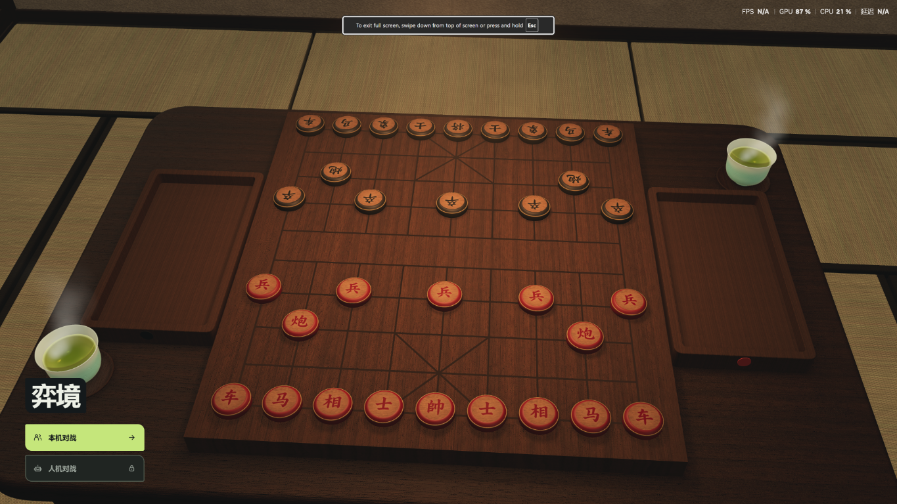

# tako-xiangqi

**立即游玩：** [https://tako-xiangqi.netlify.app](https://tako-xiangqi.netlify.app)

在静谧的和室棋室中，和朋友来一局中国象棋。支持本机双人对弈，沿用原有象棋规则；目前不含 AI 对手。

## 游戏特色

- 写实 3D 棋盘、棋子与和室场景，搭配柔和暖光、茶杯和缓缓升起的热气。
- 点击或拖动棋子即可走棋，选中时会显示合法落点。
- 可旋转、缩放棋盘视角，换边时镜头平顺转换。
- 棋子升起、落子、吃子和提子入盒均有动画反馈。
- 红黑双方使用不同的落子音效，并提供选子、吃子和悔棋音效。
- 支持悔棋、重开与胜局提示。

## 操作方式

- 点击棋子，再点击合法落点；也可以直接拖动棋子落子。
- 从棋子以外的位置拖动可旋转视角；滚轮可缩放。
- 使用界面上的“悔棋”和“重开”进行对应操作。

## 制作信息

- 技术栈：Three.js、TypeScript。
- 3D 场景与模型由 AI 辅助构建，贴图由 AI 辅助生成并整理。
- 音效由 EventLabs 生成。
