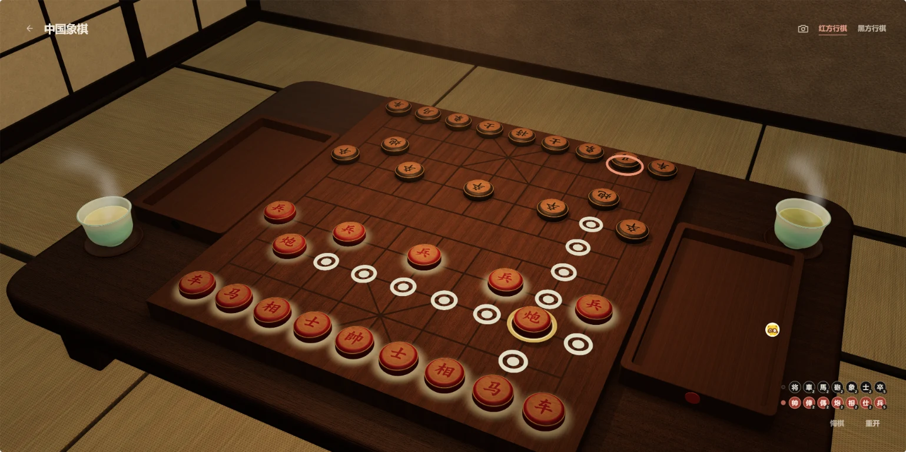

# tako-xiangqi

## English

Play Chinese chess with a friend in a quiet Japanese-style tea room, or challenge the computer at three difficulty levels. The game keeps the original chess rules.

**Play now:** [https://tako-xiangqi.netlify.app](https://tako-xiangqi.netlify.app)

### Features

- A realistic 3D board, pieces, and tea room with warm lighting, tea cups, and rising steam.
- Click or drag pieces to move; legal destinations appear when a piece is selected.
- Rotate and zoom the view, with a smooth camera turn when players switch sides.
- Piece selection, movement, captures, and captured-piece storage have animations.
- Distinct red and black move sounds, plus piece pickup, capture, and undo sounds.
- Undo, restart, and a victory screen.
- Chinese and English UI, selectable from the main menu; the choice is saved locally. Piece textures remain unchanged.
- Graphics settings for ambient occlusion, depth of field, anti-aliasing, and volumetric light.
- Automatic resource routing: mainland China (`CN`) uses Shanghai OSS; other regions use same-origin Netlify assets. Override the source in Graphics (reloads the page).

### Controls

- Select a piece and then a legal destination, or drag the piece to move it.
- Drag from an empty area to rotate the view; use the mouse wheel to zoom.
- Use the on-screen controls to undo or restart.

### Resource hosting

- Netlify deploys `netlify/edge-functions/region.js` at `/api/region` to read the visitor's country code. The response is not cached; no external IP service or database is used.
- Only `CN` selects `https://tako-threejs.oss-cn-shanghai.aliyuncs.com/tako-xiangqi/`. All other country codes, including `HK`, `MO`, and `TW`, select same-origin resources. A failed or unavailable lookup falls back to same-origin after a 2.5-second timeout and logs a warning. A VPN is classified by its exit IP.
- OSS contains `textures/`, `audio/`, `pikafish.wasm`, and `pikafish.data`. Worker and engine JavaScript remain same-origin; all local assets must stay in the Netlify deployment.
- Allow CORS `GET`/`HEAD` for the production origin and any local development origins. Serve WASM as `application/wasm`. Keep Netlify's COOP/COEP headers for the threaded engine.
- Vite development and preview do not execute Netlify Edge Functions. Use the manual resource source setting to test OSS locally; automatic mode logs a warning and uses local resources.
- Source overrides persist locally and reload the page. Engine data is cached by engine version, shared between sources. Upload matching resource versions to OSS before deploying. Transfer acceleration and R2 are not used.

### Credits

- Tech stack: Three.js and TypeScript.
- The 3D scene and models were AI-assisted; textures were AI-assisted and prepared for the game.
- Sound effects were generated with EventLabs.
- The computer opponent is [Pikafish](https://github.com/official-pikafish/Pikafish) (GPLv3, WebAssembly build running locally in the browser; the NNUE weights are for non-commercial use only).

## 中文

**立即游玩：** [https://tako-xiangqi.netlify.app](https://tako-xiangqi.netlify.app)

在静谧的和室棋室中，和朋友来一局中国象棋，或挑战三档难度的电脑对手。沿用原有象棋规则。

### 游戏特色

- 写实 3D 棋盘、棋子与和室场景，搭配柔和暖光、茶杯和缓缓升起的热气。
- 点击或拖动棋子即可走棋，选中时会显示合法落点。
- 可旋转、缩放棋盘视角，换边时镜头平顺转换。
- 棋子升起、落子、吃子和提子入盒均有动画反馈。
- 红黑双方使用不同的落子音效，并提供选子、吃子和悔棋音效。
- 支持悔棋、重开与胜局提示。
- 主菜单可切换中英文界面，自动记住选择；棋子贴图不变。
- 可调整环境光遮蔽、景深、抗锯齿与体积光。
- 自动资源分流：中国大陆（`CN`）使用上海 OSS，其余地区使用 Netlify 同源资源；画面设置中可手动选择线路（切换后刷新页面）。

### 操作方式

- 点击棋子，再点击合法落点；也可以直接拖动棋子落子。
- 从棋子以外的位置拖动可旋转视角；滚轮可缩放。
- 使用界面上的“悔棋”和“重开”进行对应操作。

### 资源托管

- Netlify Edge Function 提供不缓存的 `/api/region`，读取访问 IP 的地区代码，不依赖外部 IP 服务或数据库。只有 `CN` 使用上海 OSS，其他地区使用同源资源；查询失败或超时（2.5 秒）会记录警告并使用同源资源。VPN 按出口 IP 判断。
- OSS 基础地址为 `https://tako-threejs.oss-cn-shanghai.aliyuncs.com/tako-xiangqi/`，包含 `textures/`、`audio/`、`pikafish.wasm`、`pikafish.data`；引擎 JS 和 Worker 保持同源，Netlify 部署需保留所有原资源。
- OSS CORS 需允许正式站点及本地开发来源的 `GET`、`HEAD`；WASM 类型为 `application/wasm`。保留 Netlify COOP/COEP 响应头以支持多线程引擎。
- Vite 本地开发及预览不执行 Edge Function，自动模式会警告并使用本地资源；可在画面设置中手动选阿里云测试。选择保存在本机，切换会刷新页面。两条线路共用同版本引擎数据缓存；发布前需同步 OSS 资源。不使用传输加速或 R2。

### 制作信息

- 技术栈：Three.js、TypeScript。
- 3D 场景与模型由 AI 辅助构建，贴图由 AI 辅助生成并整理。
- 音效由 EventLabs 生成。
- 电脑对手使用 [Pikafish](https://github.com/official-pikafish/Pikafish)（GPLv3，WebAssembly 版，在浏览器本地运行；NNUE 权重仅限非商业用途）。
