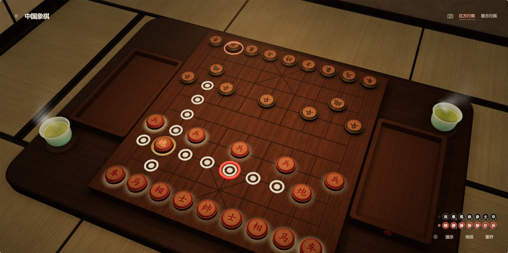

# tako-xiangqi

## [Play now · 立即游玩](https://tako-xiangqi.netlify.app)

Play Chinese chess with a friend in a quiet Japanese-style tea room, or challenge the computer at three difficulty levels.

### Features

- Local two-player games or three AI difficulty levels, with a choice of red or black.
- A wooden 3D board in a tea room, with move and capture animations and sound effects.
- Legal-move highlights, undo, restart, and victory detection including checkmate and stalemate.
- Repetition, perpetual check or chase, and move-count draws are not adjudicated.
- AI hints with a separate difficulty setting, plus red/black win estimates for reference, not precise predictions.
- A freely rotatable, zoomable view and interactive tea cups.
- Portrait screens use a steeper overview with captured pieces in boxes in front of each player.
- Chinese and English UI with adjustable graphics settings.

### Controls

- **Move:** click a piece, then a highlighted destination, or drag it there. Click the selected piece again to deselect.
- **Hint:** in AI games, click Hint to select a recommended piece and mark its destination with a pulsing red ring. Use the gear beside it to change hint difficulty, which recalculates the hint on your turn; selecting another piece or deselecting clears the hint.
- **View:** drag an empty area to rotate, scroll to zoom, or use Reset view to return to the default angle.
- **Undo / Restart:** undo a move or start over. In AI games, undo returns to your previous turn.
- **Tea:** click your own cup on your turn to take a sip.
- **Settings:** choose your language and graphics settings from the main menu.

### Technology & credits

- Tech stack: Three.js and TypeScript.
- Graphics: PBR materials, a procedurally generated room reflection map, soft shadows, contact occlusion, SSAO, SMAA, bloom, depth of field, and volumetric lighting.
- The 3D scene and models were AI-assisted; textures were AI-assisted and prepared for the game.
- Sound effects were generated with EventLabs.
- The computer opponent is [Pikafish](https://github.com/official-pikafish/Pikafish) (GPLv3, WebAssembly build running locally in the browser; the NNUE weights are for non-commercial use only).

## 中文

**立即游玩：** [https://tako-xiangqi.netlify.app](https://tako-xiangqi.netlify.app)

在静谧的和室棋室中，和朋友来一局中国象棋，或挑战三档难度的电脑对手。

### 游戏特色

- 本机双人对弈，或挑战三档难度的 AI，自选执红、执黑。
- 实木风格 3D 棋盘与和室茶室，搭配走子、吃子动画和音效。
- 合法落点高亮、悔棋、重开，以及包含将死、困毙的胜负判定。
- 暂不判定重复局面、长将长捉和自然限着和棋。
- 人机模式提供独立难度的走棋提示与红黑胜率估计；胜率仅供参考，并非精确预测。
- 可自由旋转、缩放视角，还能在思考时喝口茶。
- 竖屏采用更俯视的视角，提子盒横放在各自玩家面前。
- 支持中英文切换与画面效果设置。

### 操作方式

- **走棋：**点击棋子，再点击高亮落点，也可直接拖动落子。再次点击已选棋子可取消选中。
- **提示：**人机模式下点击“提示”，自动选中推荐棋子，并以红色呼吸光圈标出落点。旁边的齿轮可调整提示难度，轮到你时切换会立即重新计算；切换棋子或取消选中即可退出提示。
- **视角：**拖动空白处旋转，滚轮缩放；点击“恢复视角”回到默认角度。
- **悔棋 / 重开：**撤回走棋或重新开始；人机模式下悔棋会回到你上一次走棋前。
- **喝茶：**轮到你时，点击自己的茶杯喝一口。
- **设置：**在主菜单切换语言、调整画面效果。

### 技术与制作

- 技术栈：Three.js、TypeScript。
- 图形学：PBR 材质、程序生成的室内反射、软阴影、接触阴影、SSAO、SMAA 抗锯齿、泛光、景深与体积光。
- 3D 场景与模型由 AI 辅助构建，贴图由 AI 辅助生成并整理。
- 音效由 EventLabs 生成。
- 电脑对手使用 [Pikafish](https://github.com/official-pikafish/Pikafish)（GPLv3，WebAssembly 版，在浏览器本地运行；NNUE 权重仅限非商业用途）。
