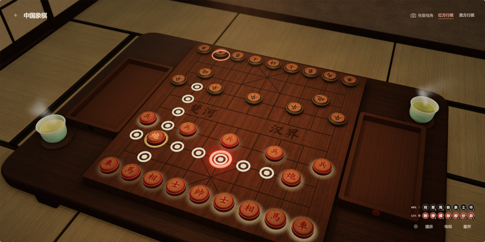

# tako-xiangqi

## 🍵 [Play now · 立即游玩](https://tako-xiangqi.netlify.app)

3D Chinese chess in a Japanese-style tea room.

### Features

- Local two-player or AI games; choose red or black.
- Wooden board, move/capture animations and sound, interactive tea cups.
- Legal-move highlights, undo, restart, checkmate and stalemate detection.
- No adjudication of repetition, perpetual check/chase, or move-count draws.
- AI hints with independent difficulty; red/black win estimates, not calibrated predictions.
- Rotate and zoom; portrait mode uses a near-top-down view with a full-width board.
- Chinese/English UI and adjustable graphics.

### AI difficulty

- **Easy:** depth 1.
- **Normal:** up to depth 5 or 400 ms per move, whichever comes first.
- **Hard:** 900 ms per move, no depth cap.

Depth counts plies (one side's move), not full turns. These are search limits, not measured Elo ratings; strength varies by device and position. All levels use Pikafish with game history and fresh search caches.

### Controls

- **Move:** click a piece and destination, or drag. Click the selected piece to deselect.
- **Hint (AI games):** selects a piece and marks its destination with a red ring. The adjacent gear changes hint difficulty; changing selection clears the hint.
- **View:** drag empty space to rotate, scroll to zoom; Reset view restores the angle.
- **Undo / Restart:** take back a move or start over; AI undo returns to your previous turn.
- **Tea / Settings:** click your cup on your turn; language and graphics are in the main menu.

### Technology & credits

- Tech stack: Three.js and TypeScript.
- Graphics: PBR materials, a procedurally generated room reflection map, soft shadows, contact occlusion, SSAO, SMAA, bloom, depth of field, and volumetric lighting.
- AI-assisted scene, models and textures; EventLabs sound effects.
- AI: [Pikafish](https://github.com/official-pikafish/Pikafish), running locally via WebAssembly (GPLv3; NNUE weights for non-commercial use only).

## 中文

和室茶室中的 3D 中国象棋。

### 游戏特色

- 本机双人或人机对弈，自选红黑。
- 实木棋盘、走子与吃子动画音效、可交互茶杯。
- 合法落点高亮、悔棋、重开、将死与困毙判定。
- 暂不判定重复局面、长将长捉和自然限着和棋。
- 走棋提示可独立选择难度；红黑胜率仅供参考，未经标定。
- 自由旋转缩放；竖屏采用近俯视视角，棋盘铺满屏幕宽度。
- 中英文界面与画质设置。

### AI 难度

- **简单：**搜索深度 1。
- **普通：**最多深度 5，或每步 400 毫秒，先到者为准。
- **困难：**每步 900 毫秒，不限搜索深度。

深度以半回合计（单方走一步），并非完整回合。以上为搜索限制，非实测 Elo；实际棋力受设备和局面影响。各档均使用 Pikafish，携带棋谱并清空搜索缓存。

### 操作方式

- **走棋：**点击棋子和落点，或直接拖动；再次点击取消选中。
- **提示（人机）：**选中推荐棋子并用红圈标记落点；旁边齿轮调整难度，切换选中棋子退出提示。
- **视角：**拖动空白处旋转，滚轮缩放；“恢复视角”还原角度。
- **悔棋 / 重开：**撤回或重新开始；人机悔棋回到你上一次走棋前。
- **喝茶 / 设置：**轮到你时点击茶杯；语言和画质在主菜单调整。

### 技术与制作

- 技术栈：Three.js、TypeScript。
- 图形学：PBR 材质、程序生成的室内反射、软阴影、接触阴影、SSAO、SMAA 抗锯齿、泛光、景深与体积光。
- AI 辅助制作场景、模型和贴图；EventLabs 生成音效。
- AI：[Pikafish](https://github.com/official-pikafish/Pikafish)，通过 WebAssembly 在浏览器本地运行（GPLv3；NNUE 权重仅限非商业用途）。
